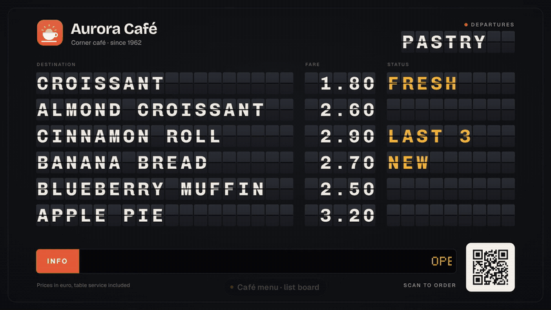
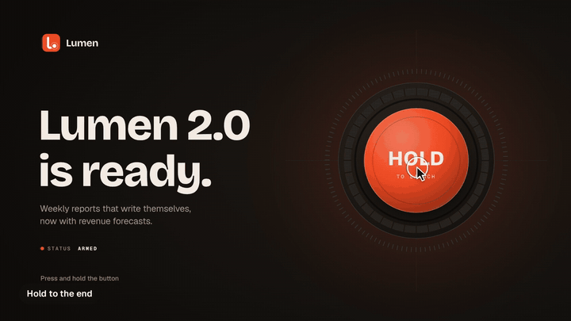
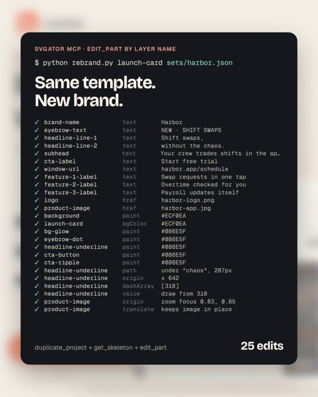
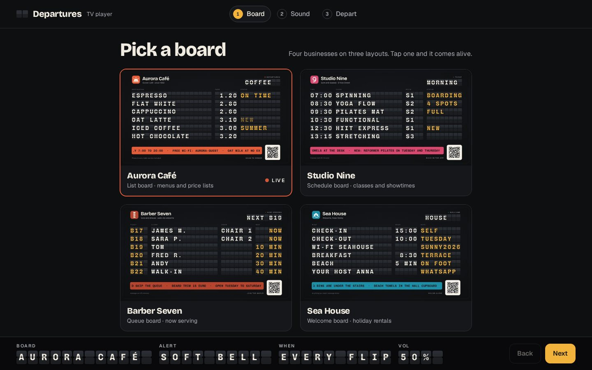
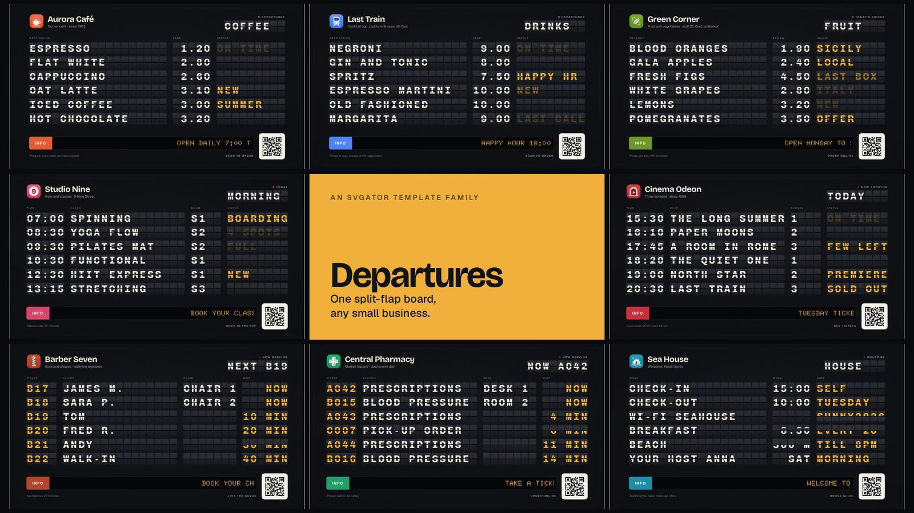
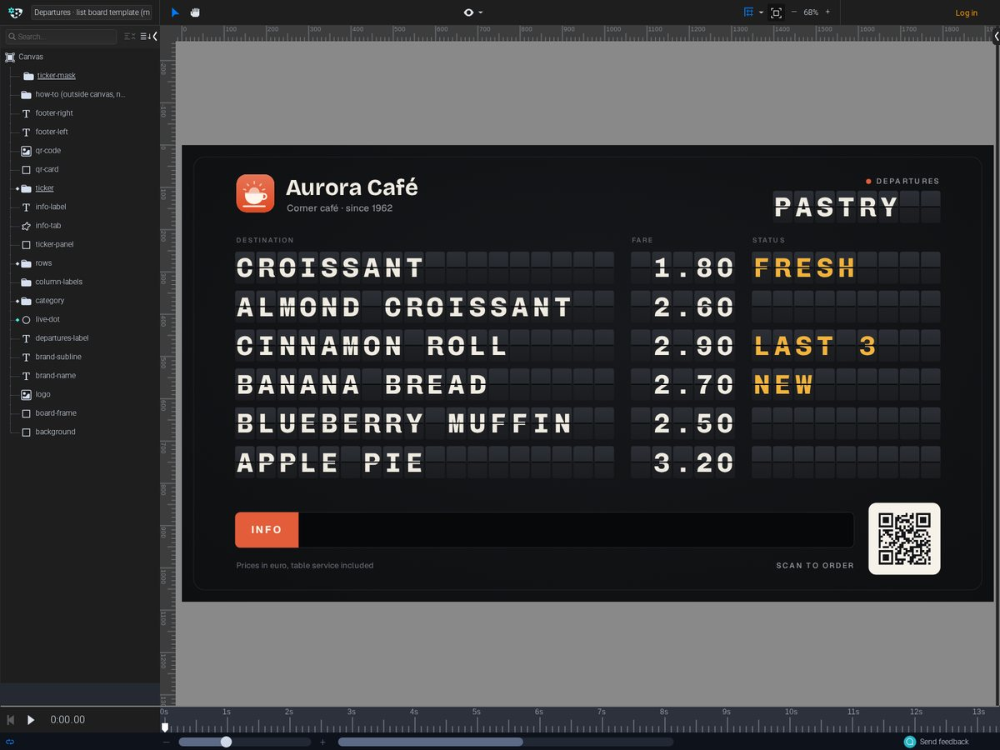
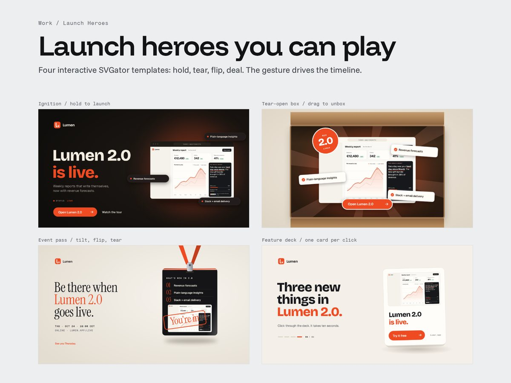
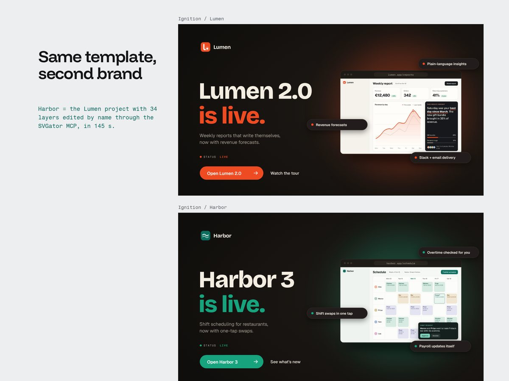

# Launch Card · animated templates that an AI agent can rebrand

[](https://m8ven.ai/mcp/valeriodon-svgator-templates-h1stal?s=readme)

Launch Card is an animated SaaS launch ad that I generated in [SVGator](https://www.svgator.com) through the SVGator MCP server, together with a script that rebrands it layer by layer, by name. I made it for the [SVGator Challenge on Contra](https://contra.com/community/topic/svgatorchallenge) in October 2026, and the same pipeline then produced my actual entry, **Departures** (split-flap boards for small businesses), and a follow-up, **Launch Heroes** (four interactive launch heroes). This repo is the source for all three and a record of the product and design decisions behind them.

| Launch Card | Departures | Launch Heroes |
| --- | --- | --- |
|  |  |  |
| 4:5 ad, 9.6 s loop · [docs](docs/launch-card.md) | 16:9 boards, 24 s loop, plus a TV player · [docs](docs/departures.md) | 16:9 interactive heroes · [docs](docs/launch-heroes.md) |

**Try them:** [Departures TV player](https://valeriodon.github.io/departures-player/) · [Departures template in SVGator](https://app.svgator.com/editor#/2298b9724f0645a0a9cdab5ba6322226) (view only) · [Launch Heroes, playable](https://valeriodonfrancesco.pro/work/launch-heroes.html) · [Departures family video](https://valeriodon.github.io/departures-player/media/departures-family.mp4)

## The brief, and the problem I set out to solve

The challenge asked for a reusable animated template made in SVGator, submitted with a public link to the project, a short story and a video that shows the template with a second set of content.

A template is only reusable if someone else can change it without breaking it. So the question I worked on was: **can an animated template be rebranded without touching a single keyframe, by a person in the editor or by an AI agent through the MCP?** That turned into three requirements I applied to every piece in this repo:

1. Everything a buyer would change (text, images, brand colour) is a named, live layer; everything else stays out of the way.
2. The second brand is made by a script that edits the template the way a person or an agent would, not redrawn.
3. The motion has to survive new content: longer words, other screenshots, other colours.

## My role

Solo project. I conceived the three pieces and made every product, design and motion call: the concepts, the visual systems, the naming conventions, the rebrand approach, and what to keep or drop after each render. Claude (Claude Code) wrote the code: the Python generators, the rebrand scripts and the JavaScript tooling, from those decisions. I judged the results from renders and contact sheets, and every commit in the original history is co-authored with it. The templates were not drawn in the SVGator editor: they were authored as SVGator documents by code and created through the SVGator MCP.

## How it came together

| Date (2026) | Step |
| --- | --- |
| 12 Oct | Launch Card generator, MCP rebrand script and proof video. First Departures board the same night. |
| 13 Oct | Departures becomes a family: list, schedule and queue layouts, eight businesses. |
| 16 Oct | Lighter boards for the editor, all content in English, sound design for the video, the TV player and its redesigned setup, LED ticker. Departures submitted. |
| 16 to 17 Oct | Launch Heroes, then a Safari performance pass on the Feature deck. |

## Key product and design decisions

### 1. Generate the templates from code, author them through the MCP

- **Context:** I needed a template, a second brand of it, and later eight boards and eight heroes, all kept in sync while the design changed.
- **Options:** draw each template by hand in the SVGator editor; or write generators that emit SVGator's document format and create or replace the project through the MCP.
- **Choice:** generators. `gen.py` builds Launch Card from a JSON content set, `board/board.py` builds Departures, `launch/*.py` build the heroes (reusing the builders from `gen.py` through `launch/kit.py`). `--replace` rewrites a project in place, so links stay valid.
- **Why:** geometry and timing become exact and live in one place (all Launch Card timings are one dictionary, `TL`), a design change is one regeneration instead of a manual rework, and the same building blocks carried over from one project to the next.
- **Trade-offs:** I had to learn SVGator's document model and its edge cases (a clip path without a transform, `hidden: true` and fixed text line height all bit me; see [docs/svgator-mcp.md](docs/svgator-mcp.md)). Visual tuning happens by regenerating and rendering, not by nudging in the editor.

### 2. Layer names are the template's interface, for people and for agents

- **Context:** `get_skeleton`, the MCP tool that reads a project's structure, returns layer titles. A person in the editor sees the same titles in the layers panel.
- **Options:** default names plus a separate guide; or names that say what each layer is and what it allows.
- **Choice:** every element gets a stable id and a readable title (`headline-line-1`, `product-image`, `page-a-row-3-price`). Layers that carry the brand colour say so (`cta-button (brand color)`), and constraints live in the name (`ticker-text (one line, up to 140 characters)`). Each template also has a "how to make it yours" note placed outside the artboard: visible in the editor, never exported.
- **Why:** one naming scheme serves both users. The rebrand scripts address layers by title, and a person finds the same handles without reading any documentation.
- **Trade-offs:** titles become a contract. Renaming a layer breaks every script that edits it.

### 3. Prove reusability with a scripted rebrand, not a second design

- **Context:** the entry had to show the template with a second content set.
- **Options:** regenerate a new project from a second JSON set (seconds, but it proves nothing about the template); or take the finished template and change it the way a user would.
- **Choice:** `rebrand.py` duplicates the template (`duplicate_project`), reads its layer names (`get_skeleton`) and applies 25 `edit_part` calls by name: texts, logo and screenshot, colours, the underline and the zoom anchor. For Launch Heroes I generalised it: `launch/rebrand.py` builds the hero with both content sets, diffs the layers by title and sends only what changed (31 to 37 edits per hero; 145 s for Ignition).
- **Why:** if a script can rebrand it through named edits, so can a person or an agent. The second brand is evidence, not decoration.
- **Trade-offs:** it is slow next to a regeneration (minutes instead of seconds) and makes many network calls, so the MCP client needed retries, backoff and session recovery (`.mcp/mcp.py`).



### 4. Treat an AI agent as a user of the template

- **Context:** the people who would run a Departures board (a café, a barber, a holiday rental) will not open an animation tool, but they may well ask an assistant.
- **Options:** have the agent regenerate the whole board from data; or have it make small named edits on the live project.
- **Choice:** small edits by name. `board/rebrand_board.py --in-place --edit layer=text` changes single cells. In the family video a chat message, "New guests tomorrow: the Müller family. Check-out is Sunday at 11:00.", becomes 3 edits that show up at the next flip.
- **Why:** it keeps whatever was already done to the board, and it matches how the request is phrased: a change, not a rebuild.
- **Trade-offs:** every edit is a round trip to SVGator. A full rebrand of a board is 52 to 65 edits and took three to five minutes.

### 5. Move on from Launch Card, keep it as groundwork

- **Context:** by the end of the first evening Launch Card worked: generator, rebrand, proof video.
- **Options:** polish Launch Card and submit it; or reuse the pipeline on a format where being a template is the whole point.
- **Choice:** I submitted Departures and kept Launch Card as the foundation (its builders, measuring and rebrand approach are reused everywhere).
- **Why:** a SaaS launch ad is a familiar format; a split-flap board only works because of a template mechanic (decision 6), and it serves small businesses that have a screen and no motion designer.
- **Trade-offs:** less time on Launch Card itself. I did come back for one layout pass (the product window now sits fully inside the canvas, the benefit pills stopped covering the screenshot's numbers, the zoom went from 1.45x to 1.7x).

### 6. Let the grid do the typesetting

- **Context:** a split-flap board needs every character in its own flap, whatever the shop types.
- **Options:** one text layer per flap (exact, but unusable as a template); or one text per field with spacing that matches the grid.
- **Choice:** one live text per field in Chivo Mono at 64 px. A monospaced glyph advances 38.4 px and the flap pitch is 50 px, so the letter spacing is the difference, 11.6 px. I picked the face after setting the same line in eight bold monospaced fonts (`board/fonts.html`).
- **Why:** type `CAPPUCCINO` or `PILATES REFORM` and each letter drops into its flap; right-aligned prices line up. Three layouts (list, schedule, queue) reuse the same mechanic with different columns, defined as data.
- **Trade-offs:** the font and its spacing are locked, and every field has a character limit (18 for a list item, 5 for a price), which the note next to the canvas spells out.

### 7. Make it light enough to open in the editor

- **Context:** the first board animated every flap on its own and changed the text with animated clip paths: 348 layers, 228 of them animated, 4,359 keyframes. Too heavy for the SVGator editor.
- **Options:** keep per-flap realism and accept a template that is hard to open; or simplify the mechanism.
- **Choice:** one composite flap strip per field of each row, and text that swaps by opacity at the instant the flap covers it: 131 layers, 59 animated, 775 keyframes (`board/board.py`; the old version is kept as `board/board_heavy.py`).
- **Why:** a template that someone can't open is not a template. Half letters still show mid-flip, which is what sells the effect.
- **Trade-offs:** flaps in the same field turn together instead of one by one.

### 8. Put sound outside the template: a TV player on the Player API

- **Context:** a split-flap board wants a sound, and SVGator exports carry no audio.
- **Options:** bake sound into a video only; or wrap the export in a page that listens to it.
- **Choice:** a single static page, the [Departures TV player](https://valeriodon.github.io/departures-player/), that plays an alert on each flip through the SVGator Player API and lets a shop owner pick the sound, retype the LED ticker and point the QR code to their own link, without touching the template. Its setup is a three-step ticket (Board, Sound, Depart) that restates the choices in split-flap cells, instead of one long settings form ([brief](docs/departures-player/BRIEF.md), [product](docs/departures-player/PRODUCT.md), [design system](docs/departures-player/DESIGN.md)).
- **Why:** it keeps the template pure and adds the one thing an export cannot carry. Because SVGator embeds only the glyphs a text uses, each board carries a hidden `led-glyphs` layer so that any new ticker message still renders in the LED font.
- **Trade-offs:** browsers block audio until the first click, so starting the board doubles as the moment sound is unlocked, and the board needs a browser rather than a video file.



### 9. Motion that survives new content, and sound used sparingly

- **Context:** in a template, motion has to work for copy and images I will never see.
- **Choice and why:**
  - Launch Card's headline rises through masks and the underline draws itself under the key word. The script measures that word with the real font in a headless browser and redraws the stroke, so the underline fits any headline.
  - The screenshot zooms into a point the user picks: the zoom is anchored on `product-image`'s anchor point, so moving one point retargets the zoom.
  - Every loop closes: Launch Card ends with a staggered exit (each group rises 24 px and fades), so 9.6 s joins back to 0 without a cut.
  - Easing is chosen per move and named in one table (`EASE` in `gen.py`): decisive arrivals, a long glide for the window, a small overshoot for pops, a separate curve for the cursor.
  - For the Departures video I iterated on sound four times, according to the commit history: flap clicks synthesized from the generator's own timings, then softer and more physical, then a single audible flap moment, and finally one soft bell under an English voiceover. The full clatter competed with the voiceover; one bell marks the update and gets out of the way.
- **Trade-offs:** measurement needs Playwright and web fonts at generation time, and results can shift by a few pixels if a font loads late.

### 10. Launch Heroes: the gesture drives one timeline

- **Context:** a launch announcement on a web page can ask for a gesture instead of autoplaying.
- **Options:** separate animations per state; or one SVGator timeline per hero split into named segments, with a page script mapping the gesture to them.
- **Choice:** one timeline per hero. Hold Ignition's button and the charge segment plays; let go and it plays back. Drag the box's tab and the tear is scrubbed. Hover the event pass to tilt it. Click the deck to throw one card per click. The generator writes each hero's segment map to a manifest for the page script.
- **Why:** each hero stays a single template that the same rebrand approach can edit, and the interaction code stays small.
- **Trade-offs:** segment times are a contract between the template and the page (each how-to note lists them). Performance became a design constraint too: the Feature deck stuttered in Safari, and after WebKit benchmarks I cut what it repaints per frame (shorter card travel, flat background, translucent shapes instead of shadow filters).

## Visuals

| | |
| --- | --- |
|  |  |
| Departures: eight fictional businesses on three layouts | The list template in the SVGator editor, layers named by role |
|  |  |
| Launch Heroes: hold, tear, flip, deal | Ignition in Lumen and in Harbor (34 named edits) |

All brands in this repo (Lumen, Harbor and the eight Departures businesses), their logos and product screens are fictional and were made for these templates. The templates use Bricolage Grotesque, Geist, Geist Mono, Chivo Mono, Doto, Big Shoulders Stencil and Instrument Serif; the video overlays add Funnel Display, Funnel Sans and Fragment Mono. All are open-source families served by Google Fonts (SIL Open Font License), referenced by name; no font files are included.

## How to run it

**Requirements:** Python 3 (tested with 3.14; the generators and the MCP client use the standard library only), Node.js with Playwright for text measurement and renders (`npm install`, then `npx playwright install chromium`), network access to Google Fonts, and ffmpeg for the video tools. `requirements.txt` lists the Python extras for the video pipeline. Run everything from the repo root unless noted.

### Offline: generate the SVGator documents (verified)

These write SVGator project JSON without touching the network, except for Google Fonts during text measurement.

```sh
mkdir -p build

# Launch Card (measures the underline word with Playwright)
python3 gen.py sets/lumen.json --out build/lumen.json

# Departures: the layout comes from the set (list, schedule or queue)
python3 board/board.py board/sets/aurora.json --out build/aurora.json
python3 board/board_heavy.py board/sets/aurora.json --out build/aurora-heavy.json

# Launch Heroes (also writes the segment manifest to build/launch/)
python3 launch/ignition.py launch/sets/lumen.json --out build/ignition.json

# Launch Heroes rebrand, dry run: lists the edits by layer name, no MCP call
cd launch && python3 rebrand.py deck PROJECT_ID sets/harbor.json --dry && cd ..
```

If `node` and Playwright are not on your `PATH`, point `PW_ENV` at a shell script that sets them up; `gen.py` sources it before measuring.

### With the SVGator MCP (needs your own credentials; not run for this public version)

Set up `.mcp/client.json` and `.mcp/token.json` as described in [docs/svgator-mcp.md](docs/svgator-mcp.md), then:

```sh
# create, or replace in place, a template in your SVGator account
python3 gen.py sets/lumen.json --create "Launch Card · Lumen"
python3 gen.py sets/lumen.json --replace PROJECT_ID

# duplicate a template and rebrand it by layer name (25 edits)
python3 rebrand.py TEMPLATE_ID sets/harbor.json --title "Launch Card · Harbor"

# Departures: new board from a template, or spot edits on a live board
python3 board/board.py board/sets/aurora.json --create "Departures · Aurora Café"
python3 board/rebrand_board.py TEMPLATE_ID board/sets/lasttrain.json
python3 board/rebrand_board.py PROJECT_ID --in-place --edit page-b-row-3-status="SOLD OUT"

# Launch Heroes (run from launch/): create, then rebrand with the diff
cd launch
python3 ignition.py sets/lumen.json --create "Ignition · Lumen"
python3 rebrand.py ignition TEMPLATE_ID sets/harbor.json
```

### Renders from an SVGator export (verified with a local export)

Export a project as SVG with the SVGator player embedded, then:

```sh
node frames.mjs export.svg build/frames 2000,4200,7400 0.5      # stills at given ms
node video.mjs export.svg build/loop.mp4 30 0.5 9600              # frame-accurate MP4 via ffmpeg
node launch/perf.mjs hero.svg build/demo.mp4 launch/video/ignition-lumen.json 30   # scripted gesture + cursor
node render.mjs assets-src/lumen-app.html build/lumen-app.png 1600 1000         # HTML to PNG
python3 sheet.py build/loop.mp4 build/sheet.png 0 9600 800                      # contact sheet (Pillow)
```

### Not runnable from this repo as-is

- `player/build_player.py` builds the TV player page; it needs the four board exports in `player/boards/`, which are not committed. The built page is in [valeriodon/departures-player](https://github.com/valeriodon/departures-player).
- `make_family_video.py`, `make_family_av.py`, `make_family_vo.py` and `launch/video/montage.py` assembled the demo videos. They need my SVGator projects, overlay frames rendered from the HTML in `video/` and `launch/video/`, and voice recordings, none of which are in the repo. They are here as a record of how the videos were made.

## Repo map

```
.mcp/                 SVGator MCP client (mcp.py, svg.py) and example credential files
gen.py                Launch Card generator; also the shared element builders
rebrand.py            Launch Card rebrand through the MCP, by layer name
sets/                 Launch Card content sets (Lumen, Harbor)
assets/, assets-src/  logos and product screenshots, and the HTML they were rendered from
measure.mjs           text measurement with the real font (Playwright)
render.mjs, frames.mjs, video.mjs, htmlseq.mjs, sheet.py   render helpers
board/                Departures: generator (board.py), first heavy version, rebrand, sets, logos, font test
player/               Departures TV player source (build_player.py) and board thumbnails
launch/               Launch Heroes: kit.py, four concepts, diff-based rebrand, sets, perf.mjs, video scripts
make_family_*.py      Departures family video: renders, captions, sound, voiceover
video/, vo/           HTML overlays for the videos, voiceover script and direction
docs/                 project docs, the TV player's product brief and design system, MCP notes
media/                images and GIFs used in these docs
```

## What I would do next

- Put a board in front of the people it is for: a shop owner editing it by chat for a week would test decision 4 better than any demo.
- Add a login script for the MCP client, so the setup is one command instead of three hand-made HTTP calls.
- Move the Launch Heroes gesture script into this repo next to the generators, so template and interaction ship together.
- Let the TV player edit board rows, not only the ticker and the QR, so small changes need neither the editor nor an agent.
- Turn the layer naming conventions into a short, written spec, so other templates can be made agent-editable by design.

---

## Support

If these templates or the tooling around them save you time, you can support my work on [GitHub Sponsors](https://github.com/sponsors/valeriodon).

## License

The code is released under the [MIT License](LICENSE). The designs are not: the templates' artwork, animations, logos, product screens and the files in `media/`, `assets/`, `assets-src/` and `board/` are © 2026 Valerio Donfrancesco, all rights reserved. The fonts belong to their authors (SIL Open Font License).

---

Conceived and designed by Valerio Donfrancesco, code written with Claude Code, built through the SVGator MCP. Related: [valeriodon/departures-player](https://github.com/valeriodon/departures-player).
