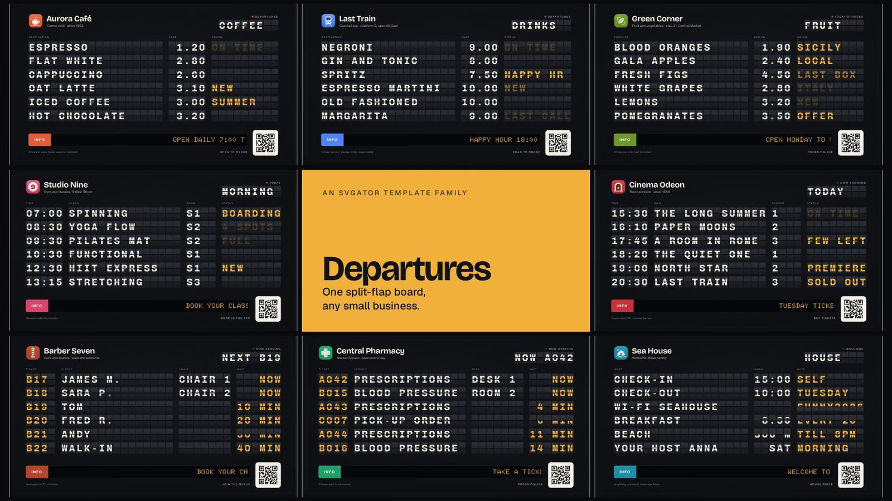
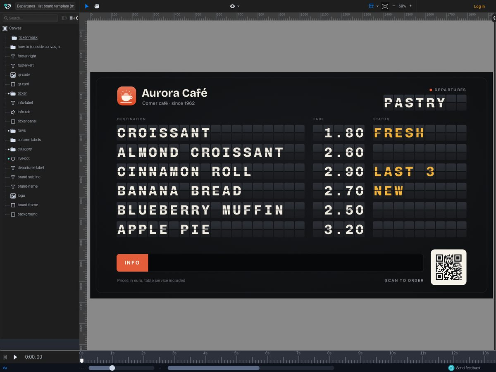
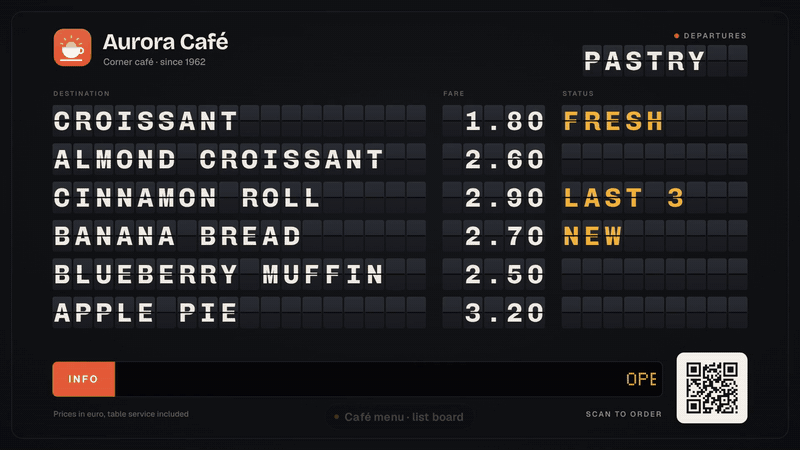
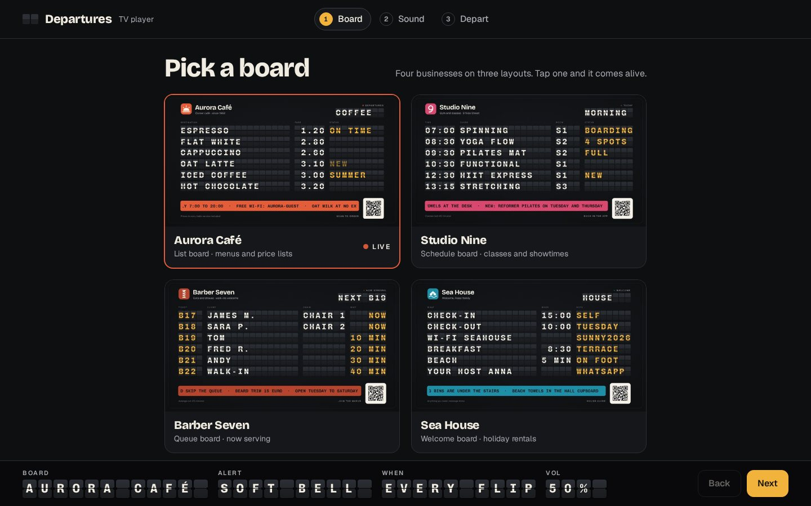

# Departures

A family of split-flap boards for the screen of a small business, built in SVGator: price lists for bars, cafés and shops, schedules for gyms and cinemas, queue boards for barbers and pharmacies, and a welcome board for holiday rentals. Every row is live text, and every 12 seconds the board flips to its second page like a station departures board. This was my entry for the SVGator Challenge.

- Template (list board, view only): https://app.svgator.com/editor#/2298b9724f0645a0a9cdab5ba6322226
- TV player with alert sounds: https://valeriodon.github.io/departures-player/ (code: [valeriodon/departures-player](https://github.com/valeriodon/departures-player), source in [`player/build_player.py`](../player/build_player.py))
- Family video (35 s): https://valeriodon.github.io/departures-player/media/departures-family.mp4

## Three layouts, one mechanic

| Layout | Columns (max characters) | Header | Examples in `board/sets/` |
| --- | --- | --- | --- |
| `list` | name 18 · price 5 (right aligned) · status 9 | DEPARTURES | Aurora Café, Last Train (cocktail bar), Green Corner (greengrocer), Sea House (holiday rental) |
| `schedule` | time 5 · event 15 · room 4 · status 8 | TODAY | Studio Nine (gym), Cinema Odeon |
| `queue` | ticket 4 · name 15 · desk 7 · wait 6 (right aligned) | NOW SERVING | Barber Seven, Central Pharmacy |

Layouts are data (`LAYOUTS` in `board/board.py`): columns, labels and header. `configure(layout)` centres the board for whatever column widths it gets.

## The trick that makes it a template

Each column of each row is one live text layer set in Chivo Mono at 64 px. A monospaced glyph advances 0.6 em (38.4 px); the flap pitch is 50 px, so the letter spacing is set to the difference (11.6 px). Whatever you type, each character lands in its own flap, and right-aligned columns keep `1.20` and `10.00` lined up. Nobody has to place letters by hand.

`board/fonts.html` is the comparison I made before picking the face: eight bold monospaced fonts (Chivo Mono, IBM Plex Mono, JetBrains Mono, Red Hat Mono, Azeret Mono, Sometype Mono, Spline Sans Mono, Martian Mono) setting the same line, `CAPPUCCINO 1,60 NEW`.

What people touch: the texts on `page-a` and `page-b`, the column labels, the board title and subline, `ticker-text`, `logo`, `qr-code`, and two brand-colour layers (`info-tab`, `live-dot`). What they don't: the flap strips, tiles and hinges are locked layers. A "how to make it yours" note sits next to the canvas, outside the artboard, so it never shows up in exports. It lists the character limits per column and tells you to keep Chivo Mono and its letter spacing, because they set the grid.

Layer names carry their own instructions where it matters: `ticker-text (one line, up to 140 characters)`, `led-glyphs (keep: embeds every LED character)`.

## The motion

- The board updates at 0.6 s and 12.6 s of a 24 s loop (page B to A, then A to B).
- A wave runs across the board: left to right by field (15 ms per flap position) and top to bottom (105 ms per row).
- Each flap is the top half of a tile that turns on its hinge (scale Y from 1 to -1) twice, 62 ms per turn; within a field, the flaps turn together as one strip. The text swaps by opacity at the instant the flap covers it, so you see half letters mid-flip, like on a real board.
- Status cells blink three times after an update, then settle.
- A live dot breathes next to the header label.
- The ticker is an amber LED dot-matrix line (Doto 900) on a black panel with an INFO tab in the venue's colour. It is one text layer, up to 140 characters, that enters from the right and scrolls by itself.

## Light enough for the editor

The first version (`board/board_heavy.py`, kept for comparison) animated every flap on its own and changed the text with animated clip paths. The current one (`board/board.py`) uses one composite flap strip per field of each row and swaps text by opacity. The price: flaps in the same field now turn together instead of one by one. Counted on the Aurora Café set by running both generators with `--out`:

| | Layers | Animated layers | Keyframes |
| --- | --- | --- | --- |
| `board_heavy.py` | 348 | 228 | 4,359 |
| `board.py` | 131 | 59 | 775 |

## Editing a board by name, by script or by chat

`board/rebrand_board.py` works on a template through the SVGator MCP, by layer name:

- Full rebrand: `duplicate_project`, then `get_skeleton` to map titles to ids, then one `edit_part` per field (brand, logo, QR, colours, labels, every cell of both pages, ticker). Five of the eight boards in the video were made this way, 52 to 65 edits each, three to five minutes per board.
- Spot edits: `--in-place --edit layer=text`. The last scene of the family video is a chat message to the holiday-rental board, "New guests tomorrow: the Müller family. Check-out is Sunday at 11:00.", applied as 3 edits and visible at the next flip.

Because every text is a named layer, an assistant can keep a board up to date for someone who will never open an animation tool: sold-out items, today's prices, tonight's showtimes, the next guest's name, the line on the ticker.

## Sound: the TV player

SVGator exports carry no audio. The TV player is a single static page that shows one board full screen and listens to it through the SVGator Player API: on each flip it plays an alert (soft bell, ding-dong, shop bell, chime, wood block, your own file, or nothing). The same panel lets a shop owner retype the ticker message and point the QR code to their own link; the player swaps both on the mounted board, without touching the template. Because SVGator embeds only the glyphs a text uses, the boards carry the hidden `led-glyphs` layer so that any new ticker message still renders in the LED font.

Product brief, direction and design system: [`docs/departures-player/`](departures-player/).

## Content and assets

All eight businesses, their logos (`board/logos2/`, exported to `board/assets/`) and the QR placeholder are fictional and made for this template. The placeholder QR encodes the text "REPLACE ME WITH YOUR MENU LINK". All content is in English; the first boards were in Italian.
