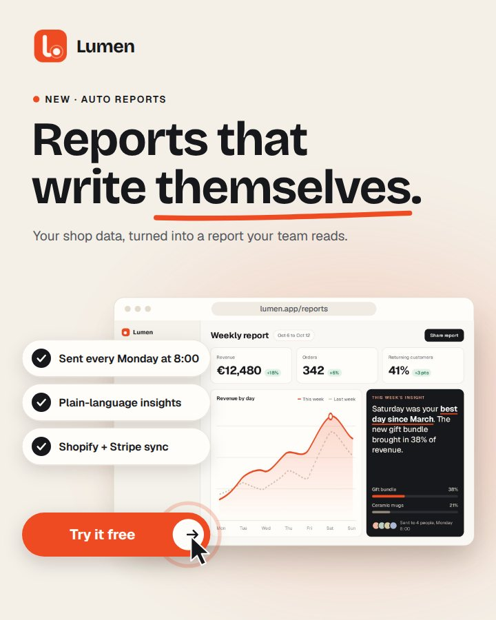
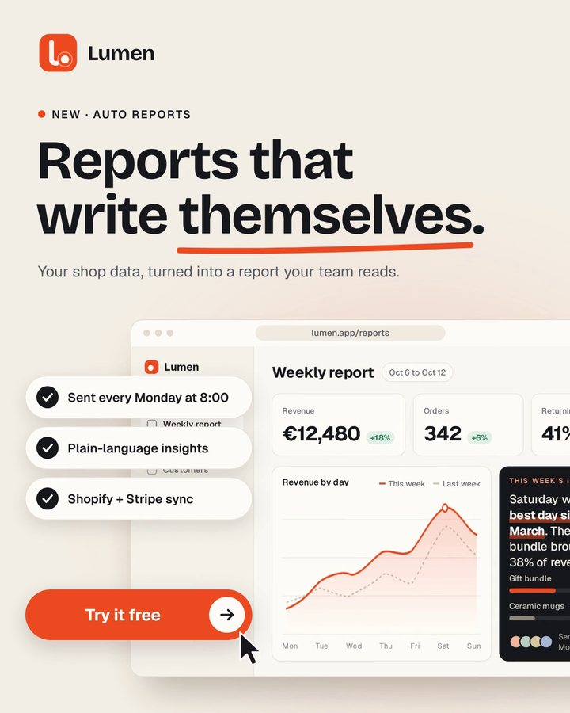
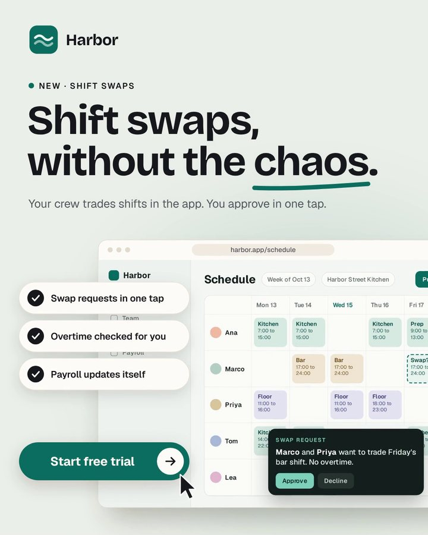
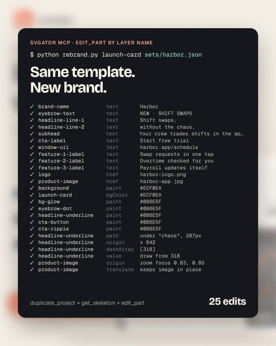

# Launch Card

A 4:5 (1080 x 1350) animated ad for announcing a new SaaS product or feature: logo, two-line headline, a product screenshot that zooms into the feature, three benefits and a clicked call to action. It loops every 9.6 s.

Every text is live, each image sits in its own named layer, and the brand colour lives in five named layers, so a team can swap in its own brand without touching a keyframe. Intended uses: LinkedIn and Instagram feed ads, product update posts, launch emails (as GIF or MP4), or an animated SVG hero on a landing page.

| Current layout (Lumen) | First layout: Lumen | First layout: Harbor, made by `rebrand.py` |
| --- | --- | --- |
|  |  |  |

The two brands were first shot in the proof video with the product window bleeding off the right edge. In a later pass I framed the whole window (right margin equal to the left margin of the benefit pills, full 16:10 screenshot), narrowed the pills to 410 px so they stop covering the screenshot's numbers, and raised the zoom from 1.45x to 1.7x. The current-layout still is rendered from an export of the regenerated template.

Both brands, their logos and their product screens are fictional and drawn for this template (`assets-src/` holds the HTML the screenshots were rendered from).

## What you can change, and how

| What | Layers |
| --- | --- |
| Text | `brand-name`, `eyebrow-text`, `headline-line-1`, `headline-line-2`, `subhead`, `feature-1/2/3-label`, `cta-label`, `window-url` (Bricolage Grotesque and Geist, both open source) |
| Images | `logo` (square) and `product-image` (16:10 screenshot, 1600 x 1000) |
| Brand colour | `bg-glow`, `eyebrow-dot`, `headline-underline`, `cta-button`, `cta-ripple` |
| Zoom | the anchor point of `product-image` is the centre of the zoom: move it onto your feature |

A "how to make it yours" note sits next to the canvas in the SVGator editor, outside the artboard, so it never shows up in exports. It gives the limits too: headline lines fit about 18 characters, feature labels about 26.

## The motion

All timings live in one dictionary (`TL` in `gen.py`), so the rhythm is tuned in one place:

1. Logo and brand name arrive (0.15 s), then the eyebrow.
2. The two headline lines rise through clip-path masks (0.6 s and 0.73 s), and a hand-drawn underline draws itself under the key word (1.45 s).
3. The product window rises with a lagging shadow; the screenshot fades in and settles.
4. The screenshot zooms 1.7x into the key metric, holds, and zooms back (2.9 s to 5.45 s).
5. The three benefits pop in with drawn checkmarks, 150 ms apart.
6. A cursor glides in and clicks the button: press, ripple, arrow nudge (7.15 s).
7. Everything leaves in a staggered exit (each group rises 24 px and fades), so the loop restarts clean at 9.6 s.

Easing is chosen per move (`EASE` in `gen.py`): a decisive arrival for text, a long glide for the window, a small overshoot (`back`) for pops, a dedicated curve for the pointer.

## How the rebrand works

`rebrand.py` turns any copy of the template into a new brand through the SVGator MCP, without downloading or rewriting the project file:

1. `duplicate_project` (unless `--in-place`).
2. `get_skeleton` to map every layer title to its id.
3. 25 `edit_part` calls, addressed by layer name: texts, the two images, the paper and accent colours, then layout. It measures the new key word with the real font (Playwright, `measure.mjs`) to redraw the underline at the right length and position, and it moves the zoom anchor of `product-image` to the set's `zoom_focus` while keeping the image in place.

A content set is a small JSON file (`sets/lumen.json`, `sets/harbor.json`): brand, accent and paper colours, logo, screenshot, eyebrow, headline, underline word, subhead, three features, CTA, URL, zoom focus.

## Numbers (from running the generator)

`gen.py sets/lumen.json --out` produces 69 layers in the tree plus 3 clip paths in the definitions, 25 of them animated, 131 keyframes in total.

## Notes for the SVGator team (MCP feedback found while building)

- `create_project` rejects a `clipPath` without `properties.transform` ("Export failed / invalid_project"); adding an identity transform fixes it. Worth a line in `describe_shape("clipPath")`.
- An element with `hidden: true` makes the project fail the same way.
- Text line height is fixed at 1 x fontSize, so multi-line body copy needs one text element per line.
