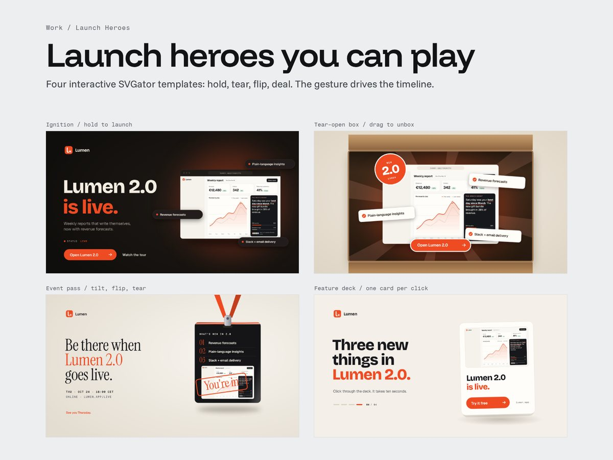
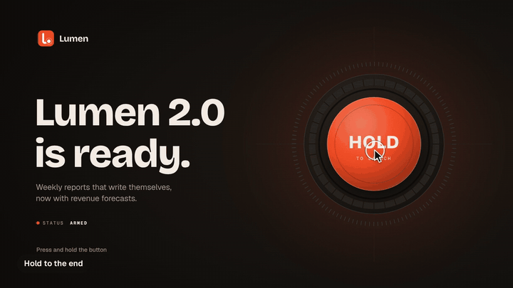
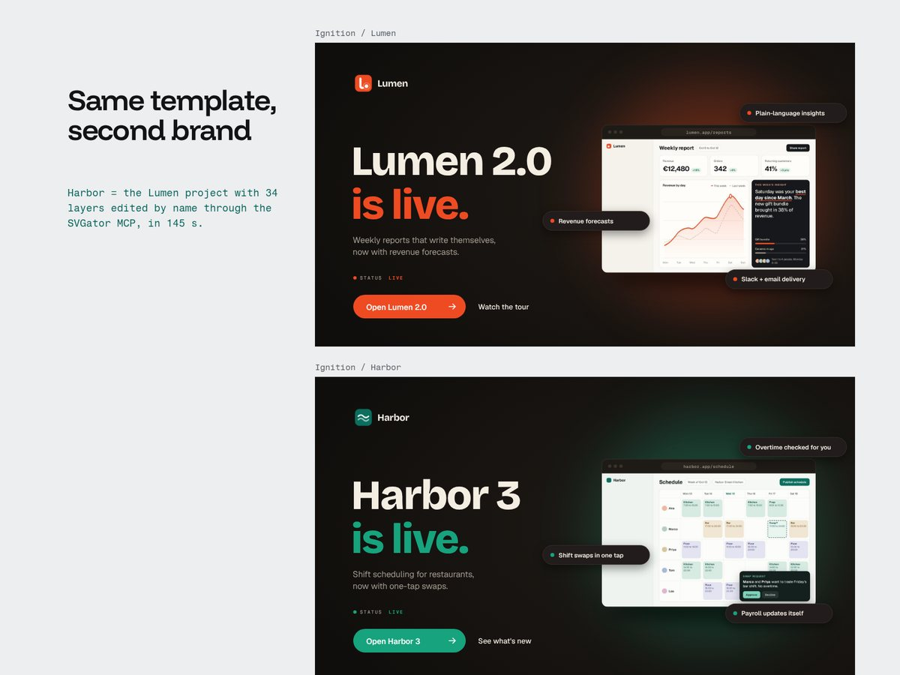

# Launch Heroes

Four interactive 16:9 launch heroes for a product release, built in SVGator after Launch Card. Each one is a single SVGator timeline split into named segments; a small page script maps a gesture to those segments through the SVGator Player API. Play them on the case study page: https://valeriodonfrancesco.pro/work/launch-heroes.html (the gesture script lives with that page, not in this repo).

## The four gestures

| Hero | Gesture | Segments (ms), from the generator |
| --- | --- | --- |
| Ignition (`launch/ignition.py`) | Hold the button: a ring charges, and at full charge the product launches. Let go early and it winds back. | intro 0-900, idle 900-1400 (loop), charge 1400-3400 (reversible), launch 3400-6000, live 6000-9000 (loop) |
| Tear-open box (`launch/box.py`) | Pull the tab: the strip tears at the pace of your finger and the box opens. | intro 0-1000, idle 1000-1800 (loop), tear 1800-3800 (scrubbed by the drag), open 3800-6800, live 6800-9800 (loop) |
| Event pass (`launch/passcard.py`) | A backstage pass on a lanyard: hover tilts it, a click flips it, a click on the stub tears it off. | intro 0-1100, tilt 1100-3100 (1600 left, 2100 centre, 2600 right), flip 3100-4250, tear 4300-5800, live 5800-7800 (loop) |
| Feature deck (`launch/deck.py`) | Each click flings away the top card and reveals the next feature. | intro 0-1300, stops at 1300, 2200 and 3100, call-to-action reveal 3100-4800, live 4800-7800 (loop) |

The generator writes each hero's segment map to `build/launch/<concept>-meta.json`, which is what the page script reads. Every hero ends in a `live` loop, so a page can leave it running after the gesture.

## Templates, not one-offs

Like Launch Card, each hero is a template: every text, image and brand colour is a named layer, and an off-canvas "how to make it yours" note explains what to change, including the Player API stops. Layers that carry the brand colour say so in their name (`cta-button (brand color)`, `glow (brand color)`), and layers with a constraint state it (`headline (stencil print, up to 9 characters)`).

`launch/kit.py` is the shared base: it reuses the element builders from `gen.py` and adds gradients, rotations, channel shortcuts, the off-canvas note and the create/replace CLI.

## The second brand, as a diff

`launch/rebrand.py` does not hard-code a list of edits. It builds the hero twice, once with the base set (`sets/lumen.json`) and once with the new one (`sets/harbor.json`), matches layers by title, and sends to `edit_part` only what differs: texts, images, colours (gradients included) and the animated channels that depend on the colour. `--dry` prints the list without touching SVGator.

| Hero | Edits to go from Lumen to Harbor (`--dry`) |
| --- | --- |
| Ignition | 34 |
| Tear-open box | 33 |
| Event pass | 37 |
| Feature deck | 31 |

For Ignition, the 34 edits took 145 s through the MCP.

## Tuned for Safari

The Feature deck stuttered in Safari. After benchmarking it in WebKit, I reduced what the deck asks the browser to repaint on every frame: each card now slides a short way to the side and fades (short travel, small area), the background is a flat colour, and card shadows are flat translucent shapes rather than blur or drop-shadow filters. The comments in `launch/deck.py` mark these choices.

## Sizes (from running the generators with `--out`)

| Hero | Layers | Animated layers | Keyframes | Loop |
| --- | --- | --- | --- | --- |
| Ignition | 97 | 50 | 358 | 9.0 s |
| Tear-open box | 151 | 25 | 146 | 9.8 s |
| Event pass | 116 | 20 | 138 | 7.8 s |
| Feature deck | 84 | 30 | 211 | 7.8 s |
